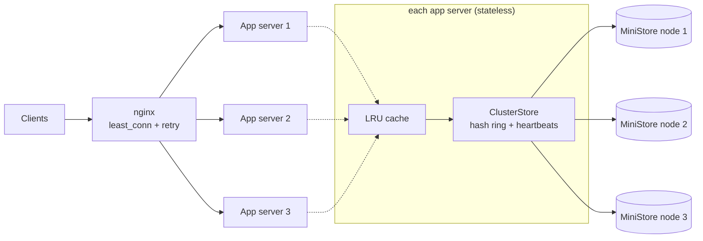

# URL Shortener on MiniStore (sharded, replicated KV store)

[](https://github.com/thunder9arch/ministore-url-shortener/actions/workflows/ci.yml) 

A URL shortener whose data lives in **MiniStore**, a key-value store built from scratch with consistent hashing, replication, heartbeats, read repair and an LRU cache.

```
POST /shorten {"url":"https://..."}  ->  201 {"code":"a1B2c3","shortUrl":"http://sho.rt/a1B2c3"}
GET  /a1B2c3                         ->  302 Location: https://...
```

## Architecture



```
client -> nginx -> app x3 -> [LRU cache] -> ClusterStore -(consistent hash, RF=2)-> MiniStore x3
```

| Piece | Where | What it does |
|---|---|---|
| App server | `src/app.js`, `routes.js` | Stateless HTTP API. Run 1 or 5, nothing changes. |
| Short codes | `src/codegen.js` | 6-char base62 (62^6 = 56.8B) from `crypto.randomBytes` (rejection sampling, no modulo bias). Reserved with atomic `setIfAbsent`; retry up to 5x on collision. |
| Hash ring | `src/cluster/ring.js` | Consistent hashing, 150 virtual nodes per node. `getNodes(key, rf)` returns the preference list (primary + replicas). |
| Replication | `src/cluster/ClusterStore.js` | Writes go to all live replicas (RF=2 default), succeed with W=1 ack. Reads walk the preference list and fail over. |
| Failure detection | `src/cluster/membership.js` | Heartbeat `GET /health` every second; 2 misses = down. Request errors mark a node down immediately (passive). Down nodes keep being pinged and rejoin on the first success. |
| Read repair | `ClusterStore.get` | A replica that misses a key is healed from one that has it. This also repairs a node that came back empty and lazily migrates data after a node is added. |
| Cache | `src/cache/LRUCache.js`, `store/CachedStore.js` | Read-through LRU in each app server. Safe because code -> URL is immutable. |
| MiniStore node | `src/ministore/node.js` | In-memory KV over HTTP (`GET/PUT/DELETE /kv/:key`, `?nx=1` = atomic put-if-absent, `/health`). |

All storage sits behind one interface, `KVStore { get, set, setIfAbsent, delete }`. The app never knows whether it talks to a `Map`, a cache, or the cluster.

## Run it

```bash
npm install
npm test                                   # 74 tests, incl. node-kill tests

# Local, no Docker: 3 nodes + 3 app servers
node scripts/cluster.js --nodes 3 --apps 3 --rf 2 --cache on
curl -X POST localhost:3001/shorten -H 'content-type: application/json' -d '{"url":"https://example.com"}'
curl -i localhost:3002/<code>              # any app server serves any code
curl localhost:3001/stats                  # cache hit rate, node health, failovers, repairs

# Docker: nginx on :8080 -> 3 apps -> 3 nodes (nodes are CPU-limited)
docker compose --profile three up --build
```
Config (env): `NODES` (comma list; unset = in-memory), `RF`, `CACHE=on|off`, `CACHE_SIZE`, `HEARTBEAT_MS`, `NODE_TIMEOUT_MS`, `PORT`, `BASE_URL`.

## Tests that prove the claims

- `ring.test.js`: keys spread 25-42% per node; adding a 4th node moves ~1/4 of keys (modulo hashing would move ~75%) and **every moved key goes to the new node**; removing a node only remaps that node's keys.
- `cluster.test.js`: each key stored on exactly RF nodes and no node holds everything; concurrent `setIfAbsent` has exactly one winner; **after killing a node, 200/200 reads still succeed**; writes continue with a node down; a replaced empty node is healed by read repair and marked up again; **end-to-end: 900 redirects through app + cache + cluster while a node is killed, 0 failures**.

## Load tests (k6)

```bash
# needs k6 on PATH; runs all 3 tests against a local cluster and writes loadtest/results/results.md + docs/*.svg
./loadtest/run-local.sh
# or against Docker/nginx:  k6 run -e BASE_URLS=http://localhost:8080 loadtest/k6/shortener.js
```
Workload: 95% redirects / 5% creates, skewed popularity (a small hot set gets most reads), 2,000 seeded links. Every redirect is checked for status 302 **and** the correct `Location`.

### Results

> **These numbers are from a 1-vCPU dev sandbox** where k6, 3 app servers and all storage nodes share one core. They show the shape, not the capability. Re-run on your machine (or in Docker with CPU limits) and replace this section before quoting any figure.

| Test | Result (1 vCPU sandbox) |
|---|---|
| 1. 1 vs 3 storage nodes, cache off | 655 vs 467 req/s. **No scaling here**: with one shared core, extra nodes only add network hops and replica writes. Run it with separate CPUs (`docker compose` limits each node to 0.25 CPU) to measure real horizontal scaling. |
| 2. Kill a node mid-test, 300 req/s, cache off | **0 failed redirects** (12.7k requests). Node killed at t=12s, restarted empty at t=24s. p95 49 ms, p99 120 ms. |
| 3. Cache off vs on, 3 nodes | 502 -> 752 req/s, p50 72.5 -> 40.1 ms, p95 172 -> 155 ms. |


Raw k6 exports: `loadtest/results/*.json`.

## Design Q&A (the interview follow-ups)

**Collision-free codes?** Random 6-char base62 + atomic `setIfAbsent` as the reservation; collisions just retry. Alternative: a counter (or per-node ID ranges) encoded in base62 gives zero collisions but guessable/sequential codes. Same `reserveCode` seam.

**Why read-heavy, and how does caching help?** Links are created once and read many times, so reads dominate (~95% here). Popularity is skewed, so a small LRU absorbs most reads and skips a network hop to the store. Immutable mappings make caching trivially safe.

**What if a node dies?** Heartbeats / failed requests mark it down; reads fail over to the replica, writes go to surviving replicas. When it returns (even empty), read repair refills it.

**Adding nodes without moving everything?** Consistent hashing: a new node takes over only ~1/N of the key space (tested). With RF=2, one old holder is always still in the key's new preference list, so read repair migrates data lazily on demand.

**Why 302, not 301?** Browsers cache 301s forever; 302 keeps links editable/expirable and analytics possible.

## Known limits (be upfront about these in interviews)

- **Consistency**: AP-leaning. `setIfAbsent` is atomic on the coordinator replica only; two app servers that disagree about which node is up could each reserve the same code on different replicas. Fixes: quorum writes + versioning, or Raft per shard. Collisions are rare (56.8B space) and the reverse index limits damage.
- **Durability**: nodes are in-memory. Surviving a full restart needs a write-ahead log/snapshot. Replica + read repair covers single-node loss.
- **Missed writes while a node is down** are healed lazily by reads, not by active anti-entropy (Merkle trees) or hinted handoff.
- **Membership is static** (env var) and each app server runs its own detector; no gossip or consensus.
- **Per-app caches** are not invalidated across servers; fine because mappings are immutable and there is no delete/update endpoint.
- `/shorten` writes the code then the reverse index non-atomically; a crash between leaves one orphan code.

## Repo layout
```
src/            app.js routes.js codegen.js validate.js buildStore.js server.js
src/store/      KVStore (interface), InMemoryStore, CachedStore
src/cache/      LRUCache
src/cluster/    ring.js membership.js ClusterStore.js
src/ministore/  node.js server.js
scripts/        cluster.js (local supervisor)  chaos.js (kill + restart a node)
loadtest/       k6/shortener.js  run-local.sh  summarize.js  results/
test/           7 suites, 74 tests
nginx.conf  nginx.local.conf  docker-compose.yml  Dockerfile
```

## Resume line (fill X from YOUR run)
"Built a URL shortener on a custom 3-node sharded, replicated key-value store (consistent hashing, heartbeats, read repair, LRU cache); sustained X req/s and survived node failure with zero failed redirects."
